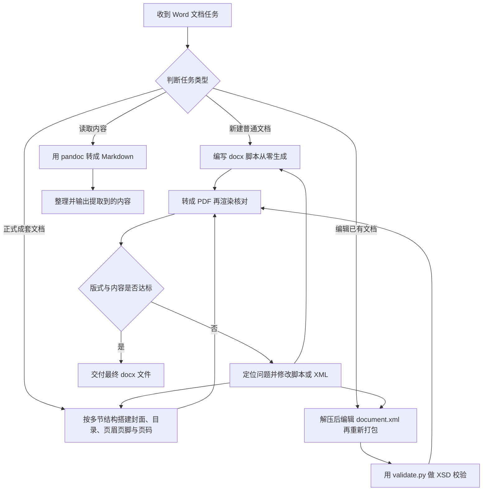

# Word（.docx）文档的创建、编辑与分析

`.docx` 本质上是一个装着若干 XML 文件的 ZIP 包。按任务类型选择做法：

| 任务 | 做法 |
|---|---|
| **新建**文档 | 编写 `docx`（npm 包）脚本生成 —— 注意下方易踩的坑 |
| **编辑**已有文档 | `unzip` 解压 → 改 `word/document.xml` → `zip` 重新打包（docx-js 打不开已有文件） |
| **读取**内容 | `pandoc -t markdown file.docx` |

> 下文脚本路径均相对于本技能所在目录。

## 何时使用

- 用户提到 Word、`.docx`、`.dotx`，或要求产出正式文档（报告、方案、合同、函件、模板等）。
- 需要从已有 Word 文档中提取、重排、替换或插入内容与图片。
- 需要处理修订痕迹（红线）、批注，或把带修订的文档整理成干净版本。
- 需要校验 Word 文档结构是否合法、或渲染成图片核对排版效果。

不适用：产物是 PDF 或电子表格的任务、在线协作文档，以及与文档无关的普通编码工作。

## 执行流程



## 用 docx-js 新建文档 —— 易踩的坑

先确认能否直接 `require('docx')`（`node -e "require('docx')"`）；能加载就直接写脚本，报错再 `npm install docx`。API 本身模型都清楚，以下是容易出错的地方：

- **页面默认是 A4。** 要美国 Letter 规格就设 `page: { size: { width: 12240, height: 15840 } }`（单位 DXA，1440 = 1 英寸）。
- **横向排版：** 仍按纵向尺寸传入，再加 `orientation: PageOrientation.LANDSCAPE` —— docx-js 会自行对调宽高。
- **表格需要双重宽度：** 表格要设 `columnWidths`，每个单元格也要设 `width`，两者都用 `WidthType.DXA`（用 `PERCENTAGE` 在 Google Docs 里会出问题）。各列宽度之和必须等于表格总宽。
- **表格底纹：** 用 `ShadingType.CLEAR`，绝不要用 `SOLID`（会渲染成黑色）。
- **列表：** 不要直接插入 `•` 字符，要用 `numbering` 配置配合 `LevelFormat.BULLET`。
- **`ImageRun` 必须带 `type:`**（`"png"`、`"jpg"` 等）。
- **`PageBreak` 必须放在 `Paragraph` 内部。**
- **不要用 `\n`** —— 用独立的 `Paragraph` 元素换行。
- **目录（TOC）：** 标题必须用内置的 `HeadingLevel.*`；自定义标题样式要设 `outlineLevel`，否则不会出现在目录里。
- **不要拿表格当分隔线** —— 应改用段落下边框。
- **点线引导、同一行右对齐：** 在 `TextRun` 里用 `PositionalTab`（`alignment: PositionalTabAlignment.RIGHT`、`leader: PositionalTabLeader.DOT`），不要用字面的 `.` 或空格去凑。

## 成套排版一份正式文档（封面 / 目录 / 页眉页脚 / 页码 / 落款）

下面这套写法已在本环境（`docx` 9.x + LibreOffice）实际跑通并通过 XSD 校验，可直接改文案复用。核心思路是**多节（section）**：封面独占一节并屏蔽页眉页脚，目录与正文合为第二节并挂上页眉、页脚与页码。

```javascript
const {
  Document, Packer, Paragraph, TextRun, Header, Footer, PageNumber,
  AlignmentType, HeadingLevel, PageBreak, NumberFormat, SectionType,
  TableOfContents, BorderStyle, VerticalAlign,
} = require('docx');

// —— 封面节：整页垂直居中，页眉页脚留空以屏蔽页码 ——
const cover = {
  properties: {
    type: SectionType.NEXT_PAGE,
    verticalAlign: VerticalAlign.CENTER,          // 内容垂直居中
    page: { size: { width: 11906, height: 16838 }, // A4 纵向，单位 DXA
            margin: { top: 1440, right: 1440, bottom: 1440, left: 1440 } },
  },
  headers: { default: new Header({ children: [new Paragraph('')] }) },
  footers: { default: new Footer({ children: [new Paragraph('')] }) },
  children: [
    new Paragraph({ alignment: AlignmentType.CENTER, spacing: { after: 480 },
      children: [new TextRun({ text: '×× 项目可行性研究报告', bold: true, size: 52 })] }),
    new Paragraph({ alignment: AlignmentType.CENTER, spacing: { after: 2400 },
      children: [new TextRun({ text: '（送审稿）', size: 28 })] }),
    new Paragraph({ alignment: AlignmentType.CENTER, children: [new TextRun({ text: '编制单位：×× 咨询有限公司', size: 24 })] }),
    new Paragraph({ alignment: AlignmentType.CENTER, children: [new TextRun({ text: '二〇二六年十月', size: 24 })] }),
  ],
};

// —— 正文节：页眉 + 页脚页码 ——
const body = {
  properties: {
    type: SectionType.NEXT_PAGE,
    page: { pageNumbers: { start: 1, formatType: NumberFormat.DECIMAL } }, // 页码从 1 重新起算
  },
  headers: { default: new Header({ children: [
    new Paragraph({ alignment: AlignmentType.CENTER,
      border: { bottom: { style: BorderStyle.SINGLE, size: 6, color: '999999', space: 4 } },
      children: [new TextRun({ text: '×× 项目可行性研究报告', size: 18, color: '666666' })] }),
  ] }) },
  footers: { default: new Footer({ children: [
    new Paragraph({ alignment: AlignmentType.CENTER, children: [
      new TextRun({ text: '— ' }),
      new TextRun({ children: [PageNumber.CURRENT] }),      // 当前页
      new TextRun({ text: ' / ' }),
      new TextRun({ children: [PageNumber.TOTAL_PAGES] }),  // 总页数
      new TextRun({ text: ' —' }),
    ] }),
  ] }) },
  children: [
    // 目录标题用普通段落手写，不要用 Heading —— 否则目录会把自己列进去
    new Paragraph({ alignment: AlignmentType.CENTER, spacing: { after: 240 },
      children: [new TextRun({ text: '目  录', size: 32, bold: true })] }),
    new TableOfContents('目录', { hyperlink: true, headingStyleRange: '1-3' }),
    new Paragraph({ children: [new PageBreak()] }),

    new Paragraph({ heading: HeadingLevel.HEADING_1, children: [new TextRun('第一章  项目概述')] }),
    new Paragraph('正文段落……'),

    // 落款：右对齐，署名与日期各占一段
    new Paragraph({ spacing: { before: 600 }, alignment: AlignmentType.RIGHT, children: [new TextRun({ text: '×× 咨询有限公司' })] }),
    new Paragraph({ alignment: AlignmentType.RIGHT, children: [new TextRun({ text: '二〇二六年十月二十一日' })] }),
  ],
};

const doc = new Document({
  features: { updateFields: true },   // 打开文档时自动刷新目录与页码域
  styles: {
    default: {
      // 中西文分别指定字体，生成的 XML 会写成 w:ascii + w:eastAsia
      document: { run: { font: { ascii: 'Times New Roman', eastAsia: 'SimSun' }, size: 24 } }, // 正文小四
      heading1: { run: { font: { ascii: 'Arial', eastAsia: 'SimHei' }, size: 32, bold: true } },
    },
  },
  sections: [cover, body],
});

Packer.toBuffer(doc).then((buf) => require('fs').writeFileSync('out.docx', buf));
```

要点与实测结论：

- **中文字体必须走 `eastAsia`。** 用字符串 `font: 'SimSun'` 会生成 `w:ascii/w:hAnsi/w:cs`，中文可能回退；用对象 `font: { ascii: 'Times New Roman', eastAsia: 'SimSun' }` 才会写入 `w:eastAsia`，中西文各自正确。字号用半磅：小四 = 24，三号 = 32。
- **封面屏蔽页码靠「空的页眉页脚」**，即在封面节显式给出 `new Header({ children: [new Paragraph('')] })`、`new Footer({ children: [new Paragraph('')] })`；不写它们会从上一节继承。
- **页码重新起算**用正文节的 `page: { pageNumbers: { start: 1, formatType: NumberFormat.DECIMAL } }`。不加 `start` 则沿用封面后的连续计数。
- **对齐 NUMPAGES 的坑：** 只要某一节设了 `pageNumbers.start`，LibreOffice 渲染出的 `NUMPAGES` 会**多算一页**（实测：正文实际 3 页显示“共 4 页”，实际 4 页显示“共 5 页”；不设 `start` 时数字正确）。这是渲染器差异，建议渲染后逐页核对页脚数字；若“共 N 页”必须精确，就改用 `PageNumber.CURRENT` 单页码，或去掉 `start` 重置。
- **目录域不会自动填内容。** docx-js 生成的只是 `TOC \h \o "1-3"` 空域，需在 Word 中打开按 F9 更新，或用 `soffice.py` 转 PDF 时自动填充。因此 `features: { updateFields: true }`（写入 `settings.xml` 的 `<w:updateFields/>`）很关键。
- **目录标题不要用 `HeadingLevel`**，否则会作为第一条被收进目录自身；用普通段落加粗居中即可。
- **落款**就是若干右对齐段落，署名与日期分开两段，段前留白用 `spacing: { before: 600 }`。
- **页眉横线**用段落下边框 `border: { bottom: { style: BorderStyle.SINGLE, ... } }`，不要用表格充当线条。

## 核对输出效果

写完 `.docx` 后，渲染出来用眼睛看：

```bash
python scripts/office/soffice.py --headless --convert-to pdf output.docx
pdftoppm -jpeg -r 100 output.pdf page
ls page-*.jpg   # 然后 Read 这些图片
```

`pdftoppm` 会按总页数的位数补零（`page-01.jpg` … `page-12.jpg`）。

## 编辑已有文档

旧的 `.doc` 文件必须先转换：`python scripts/office/soffice.py --headless --convert-to docx file.doc`。

```bash
unzip -q doc.docx -d unpacked/
find unpacked -type l -delete   # 删除符号链接条目 —— 外部来源的 docx 不可信
python scripts/merge_runs.py unpacked/   # 合并碎片化的 run，让文本可被查找
# 就地编辑 unpacked/word/document.xml —— 不要重新格式化或美化缩进
(cd unpacked && rm -f ../out.docx && zip -Xr ../out.docx .)
python scripts/office/validate.py out.docx --original doc.docx   # XSD 校验；--auto-repair 可修复常见问题
# 做红线修订？加 --author "<你用于修订的署名>"，它会检查每处修改是否都被追踪
```

Word 会把文本拆进大量 `<w:r>` 片段（修订 id、拼写检查标记等），所以你在文档里能看到的整句话，在 XML 里往往并不是一段连续字符串。`merge_runs.py` 会合并在 `word/document.xml` 中相邻且格式完全一致的 run，不改变内容也不影响渲染；它也能直接接收 `.docx`（`python scripts/merge_runs.py doc.docx -o merged.docx`）。

**修订痕迹（红线）：** 做红线时用 `--author "<你用于修订的署名>"` 校验（需配合 `--original`）—— 它会报告哪些被你改动的文本外面没有包 `<w:ins>`/`<w:del>`；这种情况很容易误犯，而且在“接受修订后”的视图里看不见。用 `<w:ins>`/`<w:del>` 包裹 run，并带上 `w:id`、`w:author`、`w:date` 属性。在 `<w:del>` 内部，文本元素是 `<w:delText>` 而不是 `<w:t>`。删除段落标记（`<w:pPr><w:rPr><w:del w:id=".." w:author=".." w:date=".."/></w:rPr></w:pPr>`）表示“把这一段并入下一段”—— 所以彻底删掉一个段落，需要它再加上用 `<w:del>` 包住其中每一个 run。`<w:del/>` 必须排在 rPr 其他子元素之前，它们的先后顺序受 schema 约束。

要生成一份「所有修订都已接受」的干净副本：`python scripts/accept_changes.py in.docx out.docx`。

接受“段落标记删除”应当把该段与下一段合并，因此一个所有 run 都被删除的段落应当彻底消失。Word 就是这么做的；但 `accept_changes.py` 和 `pandoc --track-changes=accept` 并不总是如此。两者都会犯同一个错 —— 删掉了文字，却把空段落留下来，如果原本是自动编号，就会读出一条多出来的空项目符号：

- `pandoc --track-changes=accept` 从不合并段落。
- `accept_changes.py`（底层是 LibreOffice）能正确合并，但当被删段落后面跟的是一个空行占位段落时会失效。

无论哪种视图里出现空项目符号，都是该视图的产物，不是文档本身的缺陷。请到 XML 中核对段落删除情况。

## 批注

批注需要六个互相引用的文件。用这个辅助脚本 —— 如果你同时还要改 `document.xml`，就用目录模式（省掉一轮解压/重打包）；否则用直接处理 `.docx` 的模式：

```bash
# 针对已解压的目录（同时要放置锚点标记时优先用这种）
python scripts/comment.py unpacked/ "费用与开支上限太低"
python scripts/comment.py unpacked/ "同意" --parent 0

# 直接针对 .docx 文件
python scripts/comment.py contract.docx "这个上限太低了" -o annotated.docx
```

脚本会写入 `comments.xml`、`commentsExtended.xml`、`commentsIds.xml`、`commentsExtensible.xml`、相应关系以及内容类型覆盖项，批注 ID 自动分配。随后它会打印出需要加进 `word/document.xml` 的 `<w:commentRangeStart>`/`<w:commentRangeEnd>`/`<w:commentReference>` 片段，以便把批注锚定到具体文字上 —— 在你放置这些标记之前，批注虽然存在，但不可见。

## 依赖

`docx`（npm）· `pandoc` · LibreOffice（`soffice`）· `pdftoppm`（Poppler）

先试 `node -e "require('docx')"`；报错再 `npm install docx`（本沙盒不一定预装）。渲染核对与转 PDF 都依赖 LibreOffice 的 `soffice`。
