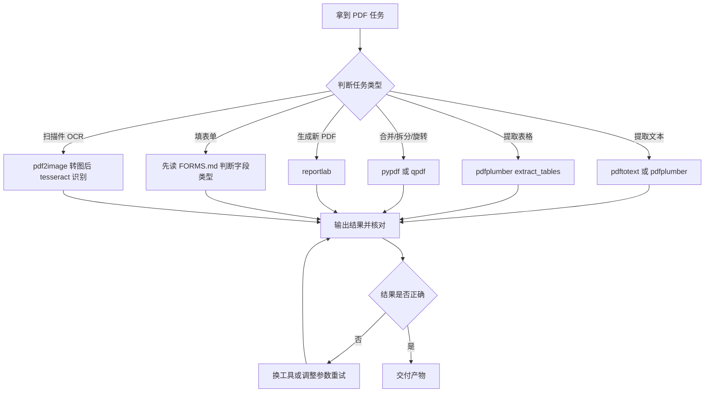

# PDF 处理指南

## 何时使用

- 用户提到 `.pdf` 文件，或要求生成一份 PDF。
- 需要从 PDF 中提取文本、表格或图片（含扫描件的 OCR 识别）。
- 需要合并、拆分、旋转、裁剪页面，或调整 PDF 结构。
- 需要添加水印、加密、解密，或处理页眉页脚之外的版面元素。
- 需要填写 PDF 表单（可填写字段或不可填写字段两种情形）。
- 不适用：Word / Excel / PPT 等 Office 文档的生成与编辑（应使用对应的 Office 技能）；与文档无关的通用编程任务。

## 执行流程



## 概述

本指南覆盖使用 Python 库和命令行工具完成 PDF 核心处理操作的方法。进阶功能、JavaScript 库和更详细的示例见 REFERENCE.md。如果需要填写 PDF 表单，请阅读 FORMS.md 并按其说明操作。

## 快速开始

```python
from pypdf import PdfReader, PdfWriter

# 读取 PDF
reader = PdfReader("document.pdf")
print(f"页数: {len(reader.pages)}")

# 提取文本
text = ""
for page in reader.pages:
    text += page.extract_text()
```

## Python 库

### pypdf —— 基础操作

#### 合并 PDF
```python
from pypdf import PdfWriter, PdfReader

writer = PdfWriter()
for pdf_file in ["doc1.pdf", "doc2.pdf", "doc3.pdf"]:
    reader = PdfReader(pdf_file)
    for page in reader.pages:
        writer.add_page(page)

with open("merged.pdf", "wb") as output:
    writer.write(output)
```

#### 拆分 PDF
```python
reader = PdfReader("input.pdf")
for i, page in enumerate(reader.pages):
    writer = PdfWriter()
    writer.add_page(page)
    with open(f"page_{i+1}.pdf", "wb") as output:
        writer.write(output)
```

#### 提取元数据
```python
reader = PdfReader("document.pdf")
meta = reader.metadata
print(f"标题: {meta.title}")
print(f"作者: {meta.author}")
print(f"主题: {meta.subject}")
print(f"创建工具: {meta.creator}")
```

#### 旋转页面
```python
reader = PdfReader("input.pdf")
writer = PdfWriter()

page = reader.pages[0]
page.rotate(90)  # 顺时针旋转 90 度
writer.add_page(page)

with open("rotated.pdf", "wb") as output:
    writer.write(output)
```

### pdfplumber —— 文本与表格提取

#### 按版面提取文本
```python
import pdfplumber

with pdfplumber.open("document.pdf") as pdf:
    for page in pdf.pages:
        text = page.extract_text()
        print(text)
```

#### 提取表格
```python
with pdfplumber.open("document.pdf") as pdf:
    for i, page in enumerate(pdf.pages):
        tables = page.extract_tables()
        for j, table in enumerate(tables):
            print(f"第 {i+1} 页的第 {j+1} 个表格:")
            for row in table:
                print(row)
```

#### 进阶表格提取
```python
import pandas as pd

with pdfplumber.open("document.pdf") as pdf:
    all_tables = []
    for page in pdf.pages:
        tables = page.extract_tables()
        for table in tables:
            if table:  # 检查表格是否为空
                df = pd.DataFrame(table[1:], columns=table[0])
                all_tables.append(df)

# 合并所有表格
if all_tables:
    combined_df = pd.concat(all_tables, ignore_index=True)
    combined_df.to_excel("extracted_tables.xlsx", index=False)
```

### reportlab —— 创建 PDF

#### 基础 PDF 创建
```python
from reportlab.lib.pagesizes import letter
from reportlab.pdfgen import canvas

c = canvas.Canvas("hello.pdf", pagesize=letter)
width, height = letter

# 添加文本
c.drawString(100, height - 100, "Hello World!")
c.drawString(100, height - 120, "This is a PDF created with reportlab")

# 添加一条线
c.line(100, height - 140, 400, height - 140)

# 保存
c.save()
```

#### 创建多页 PDF
```python
from reportlab.lib.pagesizes import letter
from reportlab.platypus import SimpleDocTemplate, Paragraph, Spacer, PageBreak
from reportlab.lib.styles import getSampleStyleSheet

doc = SimpleDocTemplate("report.pdf", pagesize=letter)
styles = getSampleStyleSheet()
story = []

# 添加内容
title = Paragraph("Report Title", styles['Title'])
story.append(title)
story.append(Spacer(1, 12))

body = Paragraph("This is the body of the report. " * 20, styles['Normal'])
story.append(body)
story.append(PageBreak())

# 第 2 页
story.append(Paragraph("Page 2", styles['Heading1']))
story.append(Paragraph("Content for page 2", styles['Normal']))

# 生成 PDF
doc.build(story)
```

#### 下标与上标

**重要**：不要在 ReportLab 生成的 PDF 中使用 Unicode 下标/上标字符（₀₁₂₃₄₅₆₇₈₉、⁰¹²³⁴⁵⁶⁷⁸⁹）。内置字体不包含这些字形，会导致它们渲染成实心黑方块。

请改用 ReportLab 在 Paragraph 对象中提供的 XML 标记：
```python
from reportlab.platypus import Paragraph
from reportlab.lib.styles import getSampleStyleSheet

styles = getSampleStyleSheet()

# 下标：使用 <sub> 标签
chemical = Paragraph("H<sub>2</sub>O", styles['Normal'])

# 上标：使用 <super> 标签
squared = Paragraph("x<super>2</super> + y<super>2</super>", styles['Normal'])
```

对于 canvas 直接绘制的文本（非 Paragraph 对象），请手动调整字号和位置，而不要使用 Unicode 下标/上标。

## 命令行工具

### pdftotext（poppler-utils）
```bash
# 提取文本
pdftotext input.pdf output.txt

# 保留版面提取文本
pdftotext -layout input.pdf output.txt

# 提取指定页面
pdftotext -f 1 -l 5 input.pdf output.txt  # 第 1-5 页
```

### qpdf
```bash
# 合并 PDF
qpdf --empty --pages file1.pdf file2.pdf -- merged.pdf

# 拆分页面
qpdf input.pdf --pages . 1-5 -- pages1-5.pdf
qpdf input.pdf --pages . 6-10 -- pages6-10.pdf

# 旋转页面
qpdf input.pdf output.pdf --rotate=+90:1  # 将第 1 页旋转 90 度

# 去除密码
qpdf --password=mypassword --decrypt encrypted.pdf decrypted.pdf
```

### pdftk（如果可用）
```bash
# 合并
pdftk file1.pdf file2.pdf cat output merged.pdf

# 拆分
pdftk input.pdf burst

# 旋转
pdftk input.pdf rotate 1east output rotated.pdf
```

## 常见任务

### 从扫描件中提取文本
```python
# 需要：pip install pytesseract pdf2image
import pytesseract
from pdf2image import convert_from_path

# 将 PDF 转为图片
images = convert_from_path('scanned.pdf')

# 逐页 OCR
text = ""
for i, image in enumerate(images):
    text += f"第 {i+1} 页:\n"
    text += pytesseract.image_to_string(image)
    text += "\n\n"

print(text)
```

### 添加水印
```python
from pypdf import PdfReader, PdfWriter

# 创建水印（或载入现有水印）
watermark = PdfReader("watermark.pdf").pages[0]

# 应用到所有页面
reader = PdfReader("document.pdf")
writer = PdfWriter()

for page in reader.pages:
    page.merge_page(watermark)
    writer.add_page(page)

with open("watermarked.pdf", "wb") as output:
    writer.write(output)
```

### 提取图片
```bash
# 使用 pdfimages（poppler-utils）
pdfimages -j input.pdf output_prefix

# 这会把所有图片提取为 output_prefix-000.jpg、output_prefix-001.jpg 等
```

### 密码保护
```python
from pypdf import PdfReader, PdfWriter

reader = PdfReader("input.pdf")
writer = PdfWriter()

for page in reader.pages:
    writer.add_page(page)

# 添加密码
writer.encrypt("userpassword", "ownerpassword")

with open("encrypted.pdf", "wb") as output:
    writer.write(output)
```

## 快速对照表

| 任务 | 推荐工具 | 命令/代码 |
|------|-----------|--------------|
| 合并 PDF | pypdf | `writer.add_page(page)` |
| 拆分 PDF | pypdf | 每页一个文件 |
| 提取文本 | pdfplumber | `page.extract_text()` |
| 提取表格 | pdfplumber | `page.extract_tables()` |
| 创建 PDF | reportlab | Canvas 或 Platypus |
| 命令行合并 | qpdf | `qpdf --empty --pages ...` |
| 扫描件 OCR | pytesseract | 先转换为图片 |
| 填写 PDF 表单 | pdf-lib 或 pypdf（见 FORMS.md） | 见 FORMS.md |

## 后续步骤

- pypdfium2 的进阶用法见 REFERENCE.md
- JavaScript 库（pdf-lib）见 REFERENCE.md
- 如果需要填写 PDF 表单，请按 FORMS.md 中的说明操作
- 故障排查指南见 REFERENCE.md
