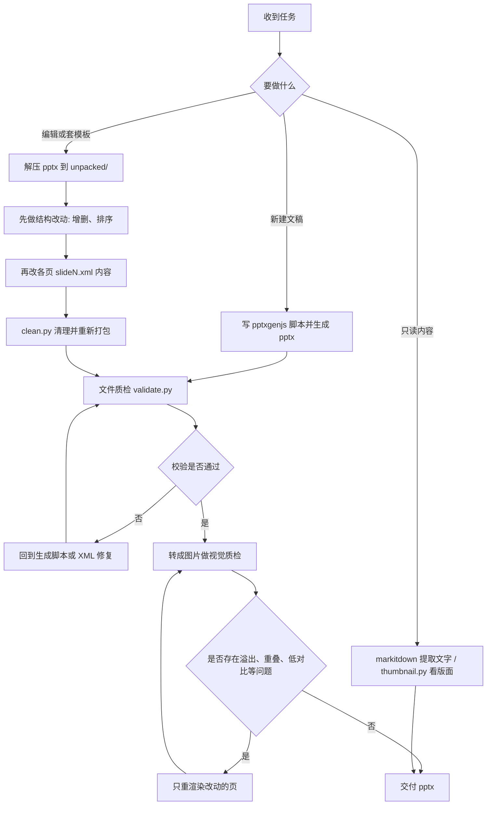

# PPTX 的创建、编辑与分析

`.pptx` 本质是一个装着一堆 XML 的 ZIP 包。先按下表选择工作方式：

| 任务 | 做法 |
|---|---|
| **新建**一份演示文稿 | 写一个 `pptxgenjs` 脚本——注意下面的踩坑清单 |
| **编辑**已有文稿，或基于模板制作 | 解压 → 修改 `ppt/slides/slideN.xml` → 重新打包 |
| **读取**内容 | `markitdown deck.pptx`（每页一个文本块，位于 `<!-- Slide number: N -->` 标记之下）；看版面缩略图：`python scripts/thumbnail.py deck.pptx` |

## 何时使用

- 用户要求**制作/起草/生成**一份演示文稿、幻灯片、路演 PPT，或最终产物是 `.pptx` 文件。
- 用户要求**读取、解析、提取**某个 `.pptx` / `.potx` 里的文字或内容（即便提取结果用于别处）。
- 用户要求**编辑、修改、更新、合并、拆分**已有演示文稿。
- 需要处理模板（`.potx`）、母版/版式、演讲者备注或批注。
- 用户提到“deck”“幻灯片”“演示文稿”“PPT”，或直接给出 `.pptx` / `.potx` 文件名。

不适用：纯 Word（.docx）或 Excel（.xlsx）任务，请改用对应的文档技能；仅仅是讨论 PPT 内容而不触碰文件时也不必触发。

## 执行流程



## 脚本

路径相对于本技能目录。其余都是普通 Python、`node` 或 shell。

| 脚本 | 用途 |
|---|---|
| `scripts/thumbnail.py deck.pptx [prefix]` | 生成带标签的幻灯片网格图，用于挑选模板版式。仅支持 `.pptx`。**务必传 `prefix`**——它默认是 `thumbnails`，会覆盖同目录下其他文稿的网格图 |
| `scripts/add_slide.py unpacked/ slide2.xml [--after slideN.xml]` | 复制一张幻灯片（或一个 `slideLayoutN.xml`），并完成全部包内登记。也可直接对 `.pptx` 操作：加 `-o out.pptx` |
| `scripts/clean.py unpacked/` | 删除不再被引用的幻灯片、媒体和关系。请在 `<p:sldIdLst>` 定稿**之后**运行 |
| `scripts/office/validate.py deck.pptx [--original src.pptx]` | 校验 schema、关系、内容类型、图表与幻灯片；每个失败项都会给出修复办法。凡是从模板派生的文稿都要加 `--original`——它会以模板为基准比对 schema 检查，避免把模板自身的 XSD 错误当成你的错误 |
| `scripts/office/soffice.py --headless --convert-to pdf deck.pptx` | LibreOffice 封装——在本沙盒里裸跑 `soffice` 会挂起 |

## 用 pptxgenjs 新建——踩坑清单

`pptxgenjs` 已预装——不要先跑 `npm install`；直接写脚本并 `require('pptxgenjs')`。只有该 require 失败时才 `npm install pptxgenjs`。API 本身模型已经掌握，下面是要命的坑：

- **先设置 `pres.layout` 再添加幻灯片。** 默认画布是 `LAYOUT_16x9` = **10" × 5.625"**，不是 13.3" 宽。超出边界的坐标会被写入而非裁剪——图形就是不在页面上。（`LAYOUT_WIDE` 是 13.3" × 7.5"。）
- **十六进制颜色：不要带 `#`，不要用 8 位。** 写成 `color: "FF0000"`。`"#FF0000"` 和把透明度烧进十六进制（`"00000020"`）都会**损坏文件**。要半透明：填充和图片用 `transparency: 0-100`，阴影用 `opacity: 0.0-1.0`——两者互不生效，且不会报错。
- **pptxgenjs 会原地修改传入的选项对象**（首次使用时把值转成 EMU）。绝不要把同一个 `shadow`/选项对象复用到两次 `add*` 调用——每次都新建一个对象。
- **阴影 `offset` 必须 ≥ 0**——负值会损坏文件。要让阴影朝上，用 `angle: 270` 配正 offset。
- **`letterSpacing` 会被静默忽略**——真正的选项是 `charSpacing`。
- **列表：** 每一项用 `bullet: true`，绝不要写实际的 `•`（会渲染成双项目符号）。除最后一项外，每个数组项都要设 `breakLine: true`。项目符号段落之间用 `paraSpaceAfter` 调间距，别用 `lineSpacing`（会出现巨大空隙）。
- **每个输出文件只 `new pptxgen()` 一次**——绝不复用实例。
- **`rectRadius` 只对 `ROUNDED_RECTANGLE` 生效**，对 `RECTANGLE` 无效。
- **不支持渐变填充**——改用渐变图片作为背景。
- **文本框自带内部留白**——当文字要与同一 x 上的形状、线条或图标对齐时，设 `margin: 0`。
- **演讲者备注写在 `slide.addNotes("...")`**（纯文本，每页一次），绝不要放进幻灯片上的文本框。
- **图表尽量用原生。** PowerPoint 能画的都用 `addChart()`（组合图传 `{type, data, options}` 数组）。对库未暴露的原生特性（趋势线、误差线），自己算好额外序列或对生成的 OOXML 做后处理——不要退化成渲染图片。只有 PowerPoint 没有原生形式的图表（桑基图、网络图、和弦图）才作为图片插入。
- **默认图表是“裸”的**——没有标题、没有数据标签、配色过时。要设 `showTitle` + `title`、`showValue: true` + `dataLabelPosition`、用调色板的 `chartColors: [...]`，并弱化边框（`catAxisLabelColor`/`valAxisLabelColor`、`valGridLine: { color, size }`、`catGridLine: { style: "none" }`、单序列设 `showLegend: false`）。
- **堆叠柱状图或条形图上，`dataLabelPosition` 必须是 `ctr`、`inEnd` 或 `inBase`。** 用 `outEnd` **会损坏文件**。
- **使用 `secondaryValAxis`/`secondaryCatAxis` 的组合序列，图表选项里必须同时有 `valAxes` 和 `catAxes`，各两项。** 否则 pptxgenjs 会写入它从未声明的轴 *id*，PowerPoint 会**丢弃该图表**并报告文件损坏。只提供 `valAxes` 不够。
- **`writeFile()` 之后，运行 `python scripts/office/validate.py deck.pptx`。** 它会报告上述两类图表缺陷以及 PowerPoint 拒绝打开的幻灯片 XML 缺陷，并给出每项的修复办法。请在生成脚本里修，而不是手工改打包后的 XML。
- **绝不要改变 `<p:presentation>` 子元素的顺序。** pptxgenjs 把 `<p:notesMasterIdLst>` 写在 `<p:sldIdLst>` 之后，并让两个母版指向同一个主题部件。PowerPoint 能正常读；一旦挪动元素，同一份文稿就再也打不开。
- **图标：** 用 `react-icons` 渲染成 SVG（`ReactDOMServer.renderToStaticMarkup`），用 `sharp` 在 ≥256px 下栅格化，再通过 `addImage({ data: "image/png;base64," + buf.toString("base64") })` 插入——`image/png;base64,` 前缀是必需的（`react-icons`、`react`、`react-dom`、`sharp` 已预装——只有 require 失败时才 `npm install react-icons react react-dom sharp`）。

## 编辑已有文稿与模板

先挑版式：`python scripts/thumbnail.py template.pptx template-thumbs` 会生成一张带标签的全页网格图并打印它创建的文件——`template-thumbs.jpg`，超过 12 页会拆成 `template-thumbs-N.jpg`。**永远要传第二个参数，并以文稿命名。** 它默认叫 `thumbnails`，所以在同一目录给两份文稿做缩略图会静默覆盖——先做的那份网格图就这样没了（仅用于模板分析——视觉质检要用 [转成图片](#转成图片) 得到的全分辨率渲染图；该脚本只接受 `.pptx`，`.potx` 请先复制成 `.pptx`）。配合 `markitdown` 把每个内容段落映射到某个模板页上，并变化版式——不要每节都套同一张“标题 + 项目符号”页。

```bash
python3 -c "import sys,zipfile; zipfile.ZipFile(sys.argv[1]).extractall('unpacked')" deck.pptx
python scripts/add_slide.py unpacked/ slide2.xml --after slide2.xml   # 复制一页（或 slideLayoutN.xml）；打印新页路径
# 调整顺序 / 删除幻灯片 = 编辑 ppt/presentation.xml 里的 <p:sldIdLst>
python scripts/clean.py unpacked/                                     # 删除之后运行：清理孤立幻灯片、媒体、关系
# 在 ppt/slides/slideN.xml 里编辑幻灯片内容
(cd unpacked && rm -f ../out.pptx && zip -Xr ../out.pptx .)           # 在目录内打包；先 rm，否则已删除的部件会残留
python scripts/office/validate.py out.pptx --original deck.pptx
```

- **所有结构性改动——增、删、排序——都要在任何页的内容编辑之前完成。** `add_slide.py` 是逐字节复制幻灯片文件，若先编辑再复制，克隆出来的是已改过的内容；而 `clean.py` 会删除任何不在 `<p:sldIdLst>` 里的幻灯片，包括你刚写好的那张。
- **绝不要手工复制幻灯片文件**——`add_slide.py` 会完成新页所需的全部登记并报告它创建了什么（`Created ppt/slides/slide17.xml from slide2.xml`）。它也能直接作用于文件：`add_slide.py deck.pptx slide2.xml -o out.pptx`——**一定要传 `-o`，否则它会原地重写输入文稿。** 复制出来的幻灯片仍然*引用*源页的图表/SmartArt/嵌入对象部件，而非克隆，所以改其中一页的图表会连带改掉另一页。
- **若你使用 `python-pptx`**，有三件事它做不到：复制幻灯片（它唯一的入口是 `add_slide(layout)`）、通过 `text_frame.text = "..."` 保留格式（会把段落塌缩成单个无样式 run——应改赋 `run.text`）、读取模板插画常用的 SVG/EMF（`add_picture` 会抛 `UnidentifiedImageError`）。
- 老式 `.ppt` 必须先转换：`python scripts/office/soffice.py --headless --convert-to pptx file.ppt`。`.potx` 模板的解包打包方式完全相同——输出保持 `.potx` 扩展名。
- 想复用一个模板里的图标或图片，就复制一张已包含它的幻灯片或版式。

往模板里填内容时：

- 如果你写脚本做 XML 变换，用 `defusedxml.minidom` 解析——用 `xml.etree.ElementTree` 往返 OOXML 会改写命名空间前缀并损坏文稿。
- **模板槽位 ≠ 源数据条目。** 若模板上是 4 个人而你有 3 个，要删掉第 4 人的整组（图片 + 文本框），而不只是它的文字——然后在质检里检查是否有孤立图形。
- 每个列表项一个 `<a:p>`——绝不把多项拼进同一段落。复制相邻的 `<a:pPr>` 以保留间距，并给标题、章节头、行内标签（`Status:`、`Owner:`）的 `<a:rPr>` 加上 `b="1"`。
- 项目符号从版式继承；只有要覆盖时才加 `<a:buChar>`、`<a:buAutoNum>`（编号）或 `<a:buNone>`——绝不在文字里写实际的 `•`。
- 首尾带空格的文字，其 `<a:t>` 需要 `xml:space="preserve"`。

## 设计思路

**不要做无聊的幻灯片。** 白底上一个接一个的项目符号打动不了任何人。每一页都可以从下面的清单里挑些想法。

### 动手之前

- **选一套大胆、由内容决定的配色**：配色要让人感觉是为*这个*主题设计的。如果把这套颜色换到一份完全不同的演示里也“能用”，说明你选得还不够具体。
- **主导而非均分**：一种颜色应占主导（60-70% 视觉权重），配 1-2 种辅助色和一个锐利的强调色。绝不要让所有颜色权重相等。
- **明暗对比**：标题页和结论页用深色背景，内容页用浅色（“三明治”结构）。或者全程深色营造高级感。
- **确定一个视觉母题**：选一个独特元素并反复使用——圆角图片框、彩色圆圈里的图标。贯穿每一页。**不要用色条或强调条纹作为母题**（见“避免”清单）。

### 配色方案

按主题选色——不要默认用通用蓝。以下配色可作灵感：

| 主题 | 主色 | 辅助色 | 强调色 |
|-------|---------|-----------|--------|
| **午夜高管** | `1E2761`（藏青） | `CADCFC`（冰蓝） | `FFFFFF`（白） |
| **森林苔藓** | `2C5F2D`（森林绿） | `97BC62`（苔绿） | `F5F5F5`（奶白） |
| **珊瑚活力** | `F96167`（珊瑚） | `F9E795`（金） | `2F3C7E`（藏青） |
| **暖陶土** | `B85042`（陶土） | `E7E8D1`（沙） | `A7BEAE`（鼠尾草） |
| **海洋渐变** | `065A82`（深蓝） | `1C7293`（青） | `21295C`（午夜） |
| **炭黑极简** | `36454F`（炭灰） | `F2F2F2`（米白） | `212121`（黑） |
| **青绿信赖** | `028090`（青绿） | `00A896`（海沫） | `02C39A`（薄荷） |
| **浆果奶油** | `6D2E46`（浆果） | `A26769`（灰玫瑰） | `ECE2D0`（奶油） |
| **鼠尾草静谧** | `84B59F`（鼠尾草） | `69A297`（桉树） | `50808E`（石板） |
| **樱桃大胆** | `990011`（樱桃红） | `FCF6F5`（米白） | `2F3C7E`（藏青） |

### 每一页

**每一页都要有视觉元素**——图片、图表、图标或形状。纯文字的页面没人记得住。

**版式选项：**
- 双栏（左文右图）
- 图标 + 文字行（彩色圆圈里的图标、加粗标题、下方描述）
- 2x2 或 2x3 网格（一侧图片，另一侧内容块网格）
- 半出血图片（占满左或右侧）叠加内容

**数据呈现：**
- 大数字标注（60-72pt 大数字，下面配小标签）
- 对比栏（前后、利弊、并列选项）
- 时间线或流程（编号步骤、箭头）

**视觉打磨：**
- 章节标题旁放小彩色圆圈图标
- 关键数据或标语用斜体强调文字

### 字体排印

**你写进 .pptx 的字体名是由用户的 PowerPoint 渲染的，不是本环境。** 你的视觉质检通过 LibreOffice 渲染，它会替换掉没有的字体——而某些字体的替代品宽度不同，于是你的质检预览可能显示出真实文稿并不存在的文字溢出（或“恰好放下”）。为让质检可信：

- **安全字体**（在质检中宽度真实，*且*随 Office 分发）：**Arial、Calibri、Cambria、Times New Roman、Courier New、Bookman Old Style、Century Schoolbook**。正文和任何对“放得下”敏感的地方都用这些。
- **零质检风险又有个性的标题**：安全清单里的衬线标题（Cambria、Bookman Old Style、Century Schoolbook）配安全清单里的无衬线正文（Calibri 或 Arial）。既有视觉对比，又不放弃可靠的溢出检查。
- **若用户要的字体不在安全清单里**（如 Georgia、Trebuchet MS）：在用户指定的位置用它，但这些容器要留约 10% 的额外余量，且不要相信这些元素上的质检文字适配——该字体的预览只是近似。用户没指定时，正文优先用安全清单里的字体。
- **质检不可靠的字体**（替代品宽度不同——溢出检查可能出错）：Georgia、Trebuchet MS、Impact、Arial Black、Garamond、Consolas、Palatino Linotype。Calibri Light 的替代因环境而异，也按质检不可靠处理。用于标题/强调并留余量尚可；别相信这些元素上的质检文字适配。
- **绝不要默认用 Aptos**——Office 2023 年后的默认字体在这里没有度量兼容的替代品，*而且*在旧版 Office 里也没有，两头都不可靠。

| 元素 | 字号 |
|---------|------|
| 幻灯片标题 | 36-44pt 加粗 |
| 章节标题 | 20-24pt 加粗 |
| 正文 | 14-16pt |
| 图注 | 10-12pt 弱化 |

### 间距

- 边距至少 0.5"
- 内容块之间 0.3-0.5"
- 留出呼吸感——不要塞满每一寸

### 避免（常见错误）

- **不要重复同一版式**——在不同页间变化栏数、卡片和标注
- **不要居中正文**——段落和列表左对齐；只居中标题
- **不要吝啬大小对比**——标题要 36pt 以上才能从 14-16pt 的正文中跳出来
- **不要默认用蓝**——选能反映具体主题的颜色
- **不要随意混用间距**——选定 0.3" 或 0.5" 并保持一致
- **不要只美化一页而其余留白**——要么全线贯彻，要么全程简洁
- **不要做纯文字页**——加图片、图标、图表或视觉元素；避免只有标题 + 项目符号
- **不要忘了文本框留白**——把线条或形状与文字边缘对齐时，给文本框设 `margin: 0`，或把形状偏移以抵消留白
- **不要用低对比元素**——图标和文字都需要与背景形成强对比；避免浅底浅字或深底深字
- **绝不要在标题下加强调线**——这是 AI 生成幻灯片的典型特征；用留白或背景色代替
- **绝不要加装饰性色条或强调条纹**——包括：横跨幻灯片宽的页眉/页脚条、沿一侧边缘的竖向侧条、卡片或内容块边缘的细强调条，以及矩形上的“单边描边”。这些都像 AI 生成的填充物。想让卡片突出，用细微的背景色、投影或图标——而不是边缘条纹。
- **不要默认用奶油/米色背景**——未指定背景时，用白色（`FFFFFF`）或用户品牌色；避免 `F5F5DC`、`FAF0E6`、`FAEBD7`、`FFF8E1` 这类暖中性默认值
- **不要交付超出形状的文字**——放不下就缩小字号、拆到多页或放大容器；绝不要让内容被裁掉或溢出边界

## 质检（必做）

你的第一版渲染通常都有几个真问题——重叠、溢出、错位。找出并修好，只重渲染改动的页，然后收手。

### 内容质检

```bash
markitdown output.pptx
```

检查内容缺失、错别字、顺序错误。

**使用模板时，检查残留的占位文字：**

```bash
markitdown output.pptx | grep -iE "\bx{3,}\b|lorem|ipsum|\bTODO|\[insert|this.*(page|slide).*layout"
```

若 grep 有输出，先修掉再宣布完成。

### 文件质检（必做）

```bash
python scripts/office/validate.py output.pptx                      # 从零新建
python scripts/office/validate.py output.pptx --original src.pptx  # 从模板派生
```

**若文稿由模板而来，一定要传 `--original`。** 模板自身可能包含 XSD 拒绝的部件，所以裸跑会报出不是你造成的失败——真正的回归就可能藏在这些噪音里。`--original` 会把 schema 与幻灯片检查与模板比对，抑制模板本来就有的错误。结构类检查——关系、内容类型、图表——会忽略 `--original`，无论哪种情况都报告模板继承来的问题，所以要独立判断它们。

pptxgenjs 会产出 PowerPoint 拒绝打开、而其他所有工具都接受的图表 XML：python-pptx 能打开这类文稿，LibreOffice 能渲染，XSD 也能通过。每个失败项都会给出修复办法。在生成脚本里修，然后重建。

### 视觉质检

把幻灯片转成图片（见 [转成图片](#转成图片)）并逐张检查。盯着生成代码久了，你会看到自己预期的东西而不是真正渲染出来的，所以要新鲜地看图（有子智能体的话很适合派它来看）。要查的用户可见缺陷：

- **文字溢出或在框/页边界被裁掉——先查这个。** 它是最常见的缺陷，且总是用户可见。（对于按“字体排印”一节预览渲染不可靠的字体，预览只是近似：相信你留的约 10% 余量，而不是它看起来是否放得下。）
- 元素重叠（文字穿过形状、线条穿过文字、元素叠在一起）
- 来源引用或页脚与上方内容碰撞
- 元素过近（间距 < 0.3"）或卡片/区块几乎相触
- 间距不均（某处大片空白，某处拥挤）
- 距页边距不足（< 0.5"）
- 栏或同类元素未对齐
- 低对比文字（如奶油底上的浅灰字）
- 文本替换后模板装饰错位——例如标题下划线是按一行定位的，但替换后的标题换行成两行
- 低对比图标（如深色背景上的深色图标且无对比圆圈）
- 文本框过窄导致过度换行
- 残留占位内容

## 转成图片

把演示文稿转成单页图片以便目视检查：

```bash
python scripts/office/soffice.py --headless --convert-to pdf output.pptx
rm -f slide-*.jpg
pdftoppm -jpeg -r 150 output.pdf slide
ls -1 "$PWD"/slide-*.jpg
```

**把上面打印出的绝对路径直接传给查看工具。** `rm` 用于清除上一轮的旧图。`pdftoppm` 按页数补零：不足 10 页为 `slide-1.jpg`，10-99 页为 `slide-01.jpg`，100 页以上为 `slide-001.jpg`。

**修完之后，重跑上面四条命令**——PDF 必须先由修改后的 `.pptx` 重新生成，`pdftoppm` 才能反映你的改动。

## 依赖

`pptxgenjs`（npm，已预装——只有 `require('pptxgenjs')` 失败时才安装）· `markitdown[pptx]`、`Pillow`、`defusedxml`、`lxml`（pip——文本导出、缩略图、清理、校验）· LibreOffice（`soffice`，通过 `scripts/office/soffice.py` 为沙盒环境自动配置）· `pdftoppm`（Poppler）
