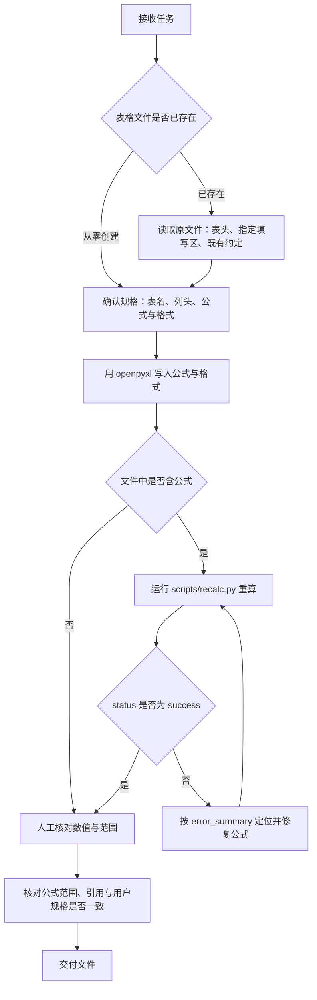

# 电子表格的创建、编辑与分析

## 何时使用

**该用：**

- 打开、读取、检查已有的 `.xlsx` / `.xlsm` / `.xltx` / `.csv` / `.tsv` 文件。
- 在已有表格里加列、写公式、改格式、做图表、修正错误公式。
- 从零创建新表格，或把其他数据源整理汇总成表格。
- 清理并重组脏数据（错行、表头错位、混入的垃圾行）为规范表格。
- 在 `.xlsx` / `.csv` / `.tsv` 等格式之间转换。
- 用户随口提到某个表格文件，想对它操作或由它产出结果。

**不该用：**

- 主要交付物是 Word 文档、PPT、HTML 报告或独立 Python 脚本。
- 任务是数据库流水线、ETL 作业或 Google Sheets API 集成——即使中间有表格数据流过。
- 只是要用 Python 处理一批结构化数据、最终不产出表格文件。

## 执行流程



| 任务 | 做法 |
|---|---|
| **创建**或**编辑**带公式、带格式的文件 | `openpyxl`——注意下文常见坑 |
| **批量导入导出**数据 | `pandas`（`read_excel`、`to_excel`） |
| **快速看一眼**某个工作表 | `markitdown file.xlsx`——每个工作表输出一个 `## 表名`；`.xlsm` 也能读。但它不给单元格坐标，别靠它规划编辑 |
| **读取模型**（公式**和**数值都要） | 用 `load_workbook` 读两遍——见下文常见坑 |

> `openpyxl`、`pandas`、`markitdown` 已预装，不要先跑 `pip install`，直接写脚本 import 即可。只有 import 失败（或 `markitdown` 命令不存在）时，才 `pip install` 缺失的那个包。

> 下文脚本路径均相对本技能目录。

## 每次交付的硬性要求

- **专业字体**（Arial、Times New Roman）贯穿全文，除非用户另有要求。
- **零公式错误。** 只要 `recalc.py` 报出 `errors_found` 就绝不能交付。如果你认为某个错误是原本就有的，拿出证据：用 `data_only=True` 加载**原始文件**查看那个单元格。你引入的错误和继承来的错误长得一模一样。
- **一律用公式，不要写死结果。** 写 `sheet['B10'] = '=SUM(B2:B9)'`，而不是 Python 算好再填进去的总数。输入变了，表格必须能自己重算。
- **严格照用户规格执行。** 表名、列头、以及用户口述的公式，都要一模一样。自作主张改成另一种算法，哪怕更优雅，也是失败。
- **每个假设和硬编码数字都要标注在读者能看到的地方**——单元格批注，或表格末尾相邻的单元格。有真实出处就引用（`来源：某公司 2024 年报第 45 页，收入附注，[SEC EDGAR 链接]`）；数字来自用户就直说。
- **你为他人填写而创建的工作簿**，要加一小段图例说明哪些单元格需要填，并给一行真实感强的示例值展示格式。用户让你编辑的已有文件，绝不要加这种示例行。
- **编辑已有文件时，完全沿用它的既有约定。** 既有约定高于本文件的所有规范。先找出它指定的填写区——通常是靠特殊字体颜色、底色或阴影标出来的——只写那里，一个已有公式都不要动。

## 重算（文件含公式时必做）

openpyxl 写进去的公式只是字符串，**不带缓存值**。在重算之前，任何读取缓存值的手段——`pandas`、`load_workbook(data_only=True)`、以及多数预览器——读到的公式单元格都是 `None`。

```bash
python scripts/recalc.py output.xlsx [超时秒数]   # 默认 30
```

LibreOffice 会计算全部公式，文件被**原地重写**，并返回 JSON：
`status`（`success` | `errors_found`）、`total_formulas`、`total_errors`，以及
`error_summary`——每类错误最多列出 100 个单元格位置（`locations_truncated` 说明省略了多少个，**要信 `total_errors`，别信列表长度**）。按它指出的位置修完再跑一遍。**返回的 JSON 里出现 `error` 键而不是 `status` 键，说明什么都没算成**，也只有这种情况会非零退出；`errors_found` 是正常退出（码 0），所以千万别把“退出码干净”当成“工作簿干净”。

**重算通过只证明公式能算，不证明算得对。** 范围差一格、引用错一行，都会得到一个干净无错但数字全错的文件。先写两三个公式确认取到的值符合预期，再铺开整片区域。

**链接到其他文件的公式会在重算时丢掉链接。** 用 openpyxl 重新保存再重算，这类公式会变成 `='[1]Returns Analysis'!$B$2`——`[1]` 是工作簿外部引用列表的下标，指向磁盘上**另一个文件**，而不是某个工作表。那个文件通常不在手边，所以单元格的缓存值是它唯一的数据来源。openpyxl 保存时会抹掉这个值；之后 LibreOffice 必须真去解析该引用，解析失败，写入 `#NAME?`，并删掉所有链接。遇到这种情况 `recalc.py` 会拒绝执行——请在覆盖保存之前，先把这些单元格的值从原文件里抄出来（`--force` 可强制覆盖，代价是接受这部分数据丢失）。

## 公式选型：要能通过校验

LibreOffice 实现的函数比 Excel 少，某个函数它算不出来，就会把一个 `#NAME?` 永久烧进你交付的文件。

- **优先用 Excel 2007 时代的函数**——`SUMIFS`、`INDEX`、`MATCH`、`IFERROR`、`SUMPRODUCT`——这些不需要任何前缀。
- **有六个 2007 之后的函数可以用，但必须带 `_xlfn.` 前缀**：openpyxl 会把你的公式原样写进 XML，而 Excel 存储 2007 之后的函数名时本就带前缀（界面把它隐藏了）。这六个是 `_xlfn.TEXTJOIN`、`_xlfn.CONCAT`、`_xlfn.IFS`、`_xlfn.SWITCH`、`_xlfn.MAXIFS`、`_xlfn.MINIFS`。不带前缀写，一律得到 `#NAME?`。
- **绝不要用 `XLOOKUP`、`XMATCH`、`SORT`、`FILTER`、`UNIQUE`、`SEQUENCE`。** 运行环境的 LibreOffice 在任何前缀下都无法计算它们。较新版本虽然能算，但它们是会溢出的数组函数，而 openpyxl 写出的文件没有溢出元数据，最终只有区域左上角那个单元格拿到值——而 `recalc.py` 在这个被截断的结果上依然报 `total_errors: 0`。查表请用 `INDEX`/`MATCH`，排序、筛选、去重在写单元格之前用 Python 做完。
- LibreOffice 无法解析的公式会被**改写成小写**——在 `#NAME?` 旁边看到小写公式，就是快速识别标志。

## openpyxl 常见坑

- **读一个模型要加载两次。** `data_only=True` 只给缓存值、公式丢失；默认加载只给公式字符串、没有值。一次加载拿不到两样。
- **`data_only=True` 一旦保存就是破坏性的。** 那个工作簿已经没有公式了，保存会把每个公式永久替换成字面值。
- **对 openpyxl 刚写完的文件用 `data_only=True`，处处读回 `None`**——先跑 `recalc.py`。（结果为空字符串 `""` 的公式也会读回 `None`。）
- **合并单元格：只写左上角锚点。** 区域内其他单元格都是 `MergedCell`，`.value` 只读。
- **`.xlsm` 不传 `keep_vba=True` 给 `load_workbook` 就会丢掉宏。**
- **表名含空格时，跨表引用必须加单引号**：`='Assumptions Inputs'!$B$5`。不加会算成 `#VALUE!`。

## 财务模型

除非用户另有要求，或已有文件本来就是另一套做法。

**颜色：** 蓝色字（`0,0,255`）表示硬编码输入和情景杠杆 · 黑色表示公式 · 绿色（`0,128,0`）表示跨表引用 · 红色（`255,0,0`）表示跨文件引用 · 黄色底（`255,255,0`）表示关键假设和待用户填写的单元格。

**数字：** 货币 `$#,##0`，单位写在列头里（`收入（百万美元）`）· 零显示为 `-`，百分比同样处理（`$#,##0;($#,##0);-`）· 负数用括号 · 百分比 `0.0%`，**以小数存储**（存 `0.15` 显示 `15.0%`；存 `15` 会显示 `1500.0%`）· 估值倍数 `0.0x` · 年份存成文本（`"2024"`，绝不要存成 `2,024`）。

**结构：** 每个假设单独占一个带标签的单元格，由用到它的公式去引用（`=B5*(1+$B$6)`，绝不写 `=B5*1.05`）· 同一条公式在每一个预测期保持一致，因为一行中间被单独改过的那一格是最常见的隐形错误 · 可能为零的分母要做保护。

## 依赖

`openpyxl`、`pandas`、`markitdown`（pip 安装，已预装——仅在 import 失败或命令缺失时安装）· LibreOffice（`soffice`，已通过 `scripts/office/soffice.py` 适配沙盒环境）
